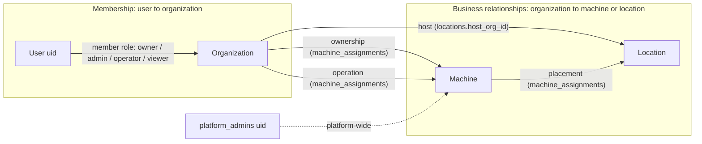

# SellMate Multi-Tenant Foundation — Revised Architecture (v2)

Status: **PLANNING — authoritative design once approved. Nothing implemented.**
Revision date: 2026-10-18. Supersedes the design sections (§3–§6, §8–§10) of
[00-audit-and-proposal.md](00-audit-and-proposal.md); that document remains the authoritative
*audit record* (§1, §2, §7.1) and is referenced here rather than repeated.

Tags: **[V]** verified in code/config today (file:line) · **[M0]** carried from Milestone 0
unchanged · **[NEW]** new or changed in this revision · **[?]** needs your input.

Companion documents:

- [Security remediation plan](../architecture/security-remediation-plan.md) — separate project.
- [Vend completion workflow](../architecture/vend-completion-workflow.md) — payment state machine; no code change yet.
- [Inventory accounting plan](../architecture/inventory-accounting-plan.md) — separate milestone.
- [Legacy client inventory](../architecture/legacy-client-inventory.md) — which clients still constrain compatibility.
- [Monorepo integration](02-monorepo-integration.md)
- [Implementation roadmap](03-implementation-roadmap.md)
- [Decision summary](04-decision-summary.md)

---

## 1. What this revision changes, in one screen

| Area | Milestone 0 | v2 |
|---|---|---|
| Organization type | `kind: platform \| operator \| host` | **No `kind`.** Orgs have a stable identity; business roles are *derived* from relationship records. |
| Relationship vocabulary | `owner / operator / placement` assignment kinds; collides with member roles | Assignment kinds renamed **`ownership / operation / placement`**; host derived from the location. |
| Host access | Deferred (`host_viewer` role) | **In scope as a relationship**, no new member role. Hosts see a revenue summary and a **field-limited machine summary**. They do not read the machine document. |
| Owner financial visibility | "Owner never sees sales" (D10) | Owner and host see **scoped revenue summaries served by the backend**; operator alone sees transactions. |
| Attribution on orders | 4 flat fields | A single immutable **`attribution` snapshot** incl. `host_org_id`, `location_id`, three assignment IDs, `currency`, `resolution`. |
| Machine doc denormalisation | `owner_org_id`, `operator_org_id`, `location_id` | adds **`host_org_id`** for backend summaries and finance queries. Hosts do not get a client read of the machine document. |
| History / audit reads | Firestore rules with `array_contains` | **Backend endpoints** (rules cannot prove multi-party membership on list queries). |
| Where Firebase config lives | `sellmate-dashboard/` root | `sellmate-dashboard/firebase/` and `dev/` laid out exactly as the future monorepo (see 02). |
| Security fixes | Mixed into M4/D14 | **Separate project** with its own plan and sequence. |
| Inventory decrement | Noted as a gap | **Separate milestone** with its own plan. |

Everything else from Milestone 0 is retained: existing Firestore paths, additive schema, Firebase
Auth for humans, rules + backend enforcement, FastAPI for privileged mutations, unchanged Pi
protocols, emulator-based local development, simulated machines and fake payments, incremental
migrations with rollback.

---

## 2. Core model

### 2.1 Three separate concepts (do not conflate)



- **Membership role** answers *"what may this person do inside this organization?"*
  Vocabulary: `owner`, `admin`, `operator`, `viewer`. Stored on
  `organizations/{org}/members/{uid}.role`. [M0]
- **Business relationship** answers *"what is this organization's relationship to this machine or
  location?"* Vocabulary: **machine owner**, **machine operator**, **location host**. Stored in
  `machine_assignments` rows (`kind: ownership | operation | placement`) and `locations.host_org_id`.
  [NEW naming]
- **Platform admin** is a per-user flag (`platform_admins/{uid}`), not an organization type and not
  a membership. `org_sellmate` is an ordinary organization that happens to own machines. [M0]

Naming discipline (binding for code, schemas, docs): a membership role is always written as
`member_role` / "member role"; relationship fields are always `owner_org_id`, `operator_org_id`,
`host_org_id`; assignment kinds are `ownership`, `operation`, `placement`. The words "owner" and
"operator" alone are ambiguous and must not appear as bare identifiers in new code. [NEW]

> **[?] Optional rename.** The member role `operator` will be read next to `operator_org_id` for
> years. If you prefer to eliminate the collision outright, rename the member role to `technician`
> (which FEATURE-013 already uses) before anything ships. Recommendation: keep `operator` as you
> specified, enforce the naming discipline above. Decision D-V2-02 in 04.

### 2.2 Why relationship-derived roles (no `kind`, no capability flags yet)

Evaluated:

- **Derived entirely from relationships** (recommended): an org "is an operator" iff it has an
  active `operation` assignment; "is a host" iff it owns a `locations` doc; "is an owner" iff it
  has an active `ownership` assignment. Nothing on the org doc to keep in sync; an org can hold
  all three roles on the same machine or across machines with zero schema change.
- **Optional capability flags** (`capabilities: { may_operate: true, ... }`): useful only if
  SellMate needs to *gate* who may enter a relationship (e.g. require Stripe Connect onboarding
  before operating). Nothing in the current product needs that; the assigning party already decides
  whom to assign, and `status: suspended` covers abuse.
- **Combination**: adds a second source of truth now for a hypothetical need.

Decision: **derived only.** Reserved extension point: an optional `capabilities` map on the org
document, absent = unrestricted; the backend's assignment transaction is the single place that
would consult it. Adding it later is additive and requires no data migration.

Example (the scenario from the brief), expressed entirely in relationship records:

```text
org_a  —ownership→ machine_1            (machine_assignments: kind=ownership, org_id=org_a)
org_a  —operation→ machine_1            (kind=operation, org_id=org_a)
org_a  —host→      loc_a_lobby          (locations/loc_a_lobby.host_org_id = org_a)
machine_2 —placement→ loc_a_lobby       (kind=placement, location_id=loc_a_lobby; operated by org_b)
org_a  —operation→ machine_3            (kind=operation, org_id=org_a; owned by org_c)
```

The dashboard derives "Org A: owns 1, operates 2, hosts 1" from three cheap queries
(`machine_assignments where org_id == A and status == active`, `locations where host_org_id == A`)
or, simpler, from the `GET /me` payload (see §6.2) — no org-level counters to maintain.

---

## 3. Authorization model

### 3.1 Effective permission = member role × relationship

A capability check always has three inputs: the user's **member role** in the org they are acting
as (`activeOrgId`), that org's **relationship(s)** to the target machine/location, and the
capability. An org may hold several relationships to the same machine; the effective grant is the
**union** of what each relationship grants. Platform admins bypass the relationship requirement
but still produce audit events.

```python
# Shape of the single backend check (authz.py, design only)
def allowed(uid, org_id, capability, *, machine=None, location=None) -> bool:
    if is_platform_admin(uid): return True
    role = member_role(uid, org_id)            # None if not an active member
    if role is None: return False
    rels = relationships(org_id, machine, location)   # subset of {"ownership","operation","host"}
    return any(role in CAPS[capability][rel] for rel in rels | {"org"})
```

`CAPS` is loaded from the shared `capabilities.json` (authoritative copy: see 02 §3) and the same
file drives UI gating and rules tests. UI gating is cosmetic; enforcement is rules or backend only.

### 3.2 Member roles — retained, sufficient

`owner`, `admin`, `operator`, `viewer` + non-membership `platform_admin`. [M0]

Reviewed against the three relationships: no additional role is needed because *what* an org can
see is decided by relationship, and *who in the org* may change things is decided by role. A host
org, for example, simply adds its staff as `viewer`s. `host_viewer` from Milestone 0 §4.4 is
dropped. [NEW]

Rules of thumb retained [M0]: nobody edits their own membership; `admin` cannot grant/revoke
`owner`; all membership and relationship changes write audit events.

### 3.3 Permission matrix (relationship-aware)

Legend: role threshold is the *minimum* member role in the acting org; `—` = not granted via that
relationship. Read as "capability is granted if the acting org holds the relationship *and* the
member has at least the listed role". `PA` = platform admin always.

**Organization-scoped (no machine relationship needed)**

| Capability | min role |
|---|---|
| `org.view`, `members.view`, `locations.view` | viewer |
| `org.settings.edit`, `members.manage` (≤ admin), `locations.manage` | admin |
| `members.manage_owner` | owner |
| `audit.view` (org's own events) | admin |
| `org.delete` | owner (backend refuses while any active relationship exists) |

**Machine-scoped**

| Capability | via `operation` | via `ownership` | via `host` |
|---|:-:|:-:|:-:|
| `machine.view` (full machine doc, including reader id and health detail) | viewer | viewer | — |
| `machine.host_summary.view` (identity, placement, online/offline only) | — | — | viewer |
| `machine.edit_display` (`display_name`, `status`) | admin | — | — |
| `inventory.view`, `planogram.view` | viewer | — | — |
| `inventory.edit`, `planogram.edit` | operator | — | — |
| `sales.view_transactions` (orders, vend jobs, product-level) | viewer | — | — |
| `finance.summary.view` (scoped revenue summary, §5) | viewer | viewer | viewer |
| `health.view_detail` (`health_current` incl. hardware issues) | viewer | viewer | — (status only, see note) |
| `commissioning.run` | operator | — | — |
| `commissioning.force_activate` | admin | — | — |
| `theme.publish` (future ID-token path) | operator | — | — |
| `assignments.view_history` (rows naming the acting org) | viewer | viewer | viewer |
| `machine.assign_operator` / `machine.end_operation` | admin (end own only) | admin | — |
| `machine.place` (new location; pilot also requires platform admin) | admin | admin | — (see note) |
| `machine.end_placement` (leave, no new location) | admin | admin | — |
| `machine.transfer_ownership` | — | owner | — |
| `machine.register` (create `machines/{id}` owned by acting org) | n/a | admin | — |
| `devices.manage` (issue/rotate per-machine credential) | — | admin | — |

Notes:

- *Host does not read the machine document.* `machines/{id}` holds `stripe_reader_id`
  (`main.py:627`), `health_current` (hostname, hardware, services, errors;
  `health_status.py:171-198`), theme, and topology. Firestore cannot hide fields of a document
  the host is allowed to read, so host members get **no** client read on `machines/{id}` or its
  subcollections. `GET /machines/{id}/summary?as=host` returns `machine_id`, `display_name`,
  `location_id`, `location_name`, `placement_assignment_id`, and an online/offline status derived
  from `last_seen_at`. It omits reader ids, credentials, health detail, theme, topology,
  inventory, and payments. Owner and operator members still read the machine document, because
  they operate the hardware. A stored `machine_host_summaries` document can replace the endpoint
  later if a realtime listener is needed; the response shape is already that document.
- *Who may relocate a machine.* An admin of the owner org or of the operator org may initiate a
  move. Placing the machine at a location requires that location's host to authorize it. For the
  pilot there is no approval queue: a platform administrator commits the placement in the same
  request, and the row records both the initiator and `host_authorization.method = platform_admin`.
  `host_member` is a reserved method. The endpoint rejects it until a later change enables it.
  Enabling it is an allow-list change, not a new collection. Ending a placement without a new
  location does not require the host. The host cannot move the machine on their own. [REVISED]
- *Devices.* Credential issuance sits with the owner org because the hardware is theirs; platform
  admin covers SellMate-provisioned fleets. Re-evaluate if operators routinely re-image Pis.
- *Same org, multiple relationships.* Union applies: an org that owns and operates a machine gets
  the `operation` column plus `ownership` column. Tested explicitly (fixture `org_a` in §8).

### 3.4 Where each capability is enforced, and the rules-hard cases

| Capability group | Firestore rules (client SDK) | Backend (Admin SDK, ID token) |
|---|---|---|
| `machine.view`, `inventory.*view`, `planogram.*view`, `sales.view_transactions`, `members.view`, `org.view`, `locations.view` | ✓ single-field equality scoping | ✓ when served via API |
| `inventory.edit`, `planogram.edit`, `machine.edit_display` | ✓ field-whitelisted writes (operator org members) | optional later |
| `finance.summary.view`, `assignments.view_history`, `audit.view` | **✗ denied to clients** | ✓ only path |
| `members.manage*`, `org.settings.edit`, `locations.manage`, `machine.register/assign/place/transfer`, `devices.manage` | ✗ denied | ✓ transactional + audit |
| `platform.*` | `platform_admins/{uid}` exists | ✓ same check |

Cases where Firestore's query-based rules make a permission hard, and the chosen alternative:

| Hard case | Why rules cannot do it | Simplest secure alternative |
|---|---|---|
| Owner/host read of *their share* of order data | Rules grant whole documents; a read of `orders` would expose items, PI IDs and the operator's full sales. | Backend `GET /finance/summary` computes scoped aggregates (§5.3). No client read of `orders` except by operator org. |
| Machine relationship history (all rows for machine M) | List rule must hold for every possible result; rows name different parties; rules cannot iterate `party_org_ids` nor know which org the client "acts as". | Backend `GET /machines/{id}/assignments` filters rows to those naming any org the caller belongs to. Client reads of `machine_assignments` denied. |
| Audit events involving two orgs | Same multi-party problem (`related_org_ids array_contains` cannot be tied to a verified membership in rules). | Backend `GET /orgs/{org}/audit`. Client reads denied. |
| Location doc read by an operator placed there | Needs a join through `machine_assignments`. | Denormalise `location_id`, `location_name`, `host_org_id` onto the machine doc; operators rarely need the location doc. Host and platform read `locations` directly. [M0 + host_org_id] |
| "Which orgs am I in?" | Collection-group query on `members` by `uid`. | Explicit collection-group rule `match /{path=**}/members/{uid} { allow read: if request.auth.uid == uid }` + index. Works and is tested with the exact dashboard query. [M0] |
| Membership-derived role inside rules | Needs `get()` of the membership doc (1 read) and, for subcollections, `get()` of the parent machine (1 more). | Accepted cost (≤3 reads per evaluation); custom claims remain a later optimisation (M0 option C). |

---

## 4. Relationship records and history

### 4.1 Invariants [M0, kinds renamed]

- Per machine, at most **one active** row of each kind: `ownership`, `operation`, `placement`.
  "Unassigned" (no active `operation`) and "unplaced" are legal states.
- `effective_from` is server time; past dates only via the approved migration tool; no future-dated
  rows (D12).
- Every change runs in **one Firestore transaction** in the backend: read machine + version → check
  `expected_assignment_version` (409 on mismatch) → end current row → create new row → update the
  denormalised machine fields (`owner_org_id`, `operator_org_id`, `location_id`, `location_name`,
  `host_org_id`, `*_assignment_id`, `assignment_version`) → write `audit_events`. Clients cannot
  write any of these.
- Ending an `operation` row does **not** wait for in-flight orders (see §4.3).

### 4.2 Deriving `host_org_id`

Placement names a `location_id`; the host is `locations/{location_id}.host_org_id`. The transaction
copies it onto the machine doc as `host_org_id` and onto the placement row as
`host_org_id_at_change`, so later reads never need the join and a location changing hands does not
silently rewrite history. If a location's `host_org_id` changes (rare; it is a sale of a venue),
the backend treats it as *end placement + new placement* for every machine there, which creates
proper history rows. [NEW]

### 4.2.1 Placement authorization (pilot)

A placement write is one backend transaction, the same transaction as §4.1. No `pending_placements`
collection and no notification flow.

- **Initiate.** `initiated_by.org_id` must be the machine's current owner org or operator org.
  The caller is an admin (or owner) of that org, or a platform admin acting for that org.
- **Authorize the location.** The target `locations/{id}.host_org_id` is copied onto the row.
  In the pilot the only accepted `host_authorization.method` is `platform_admin`, and the caller
  must be a platform admin. `host_member` returns 400 `host_approval_not_enabled`.
- **End only.** `location_id: null` clears placement. Owner admin, operator admin, or platform
  admin. `host_authorization` is null.

```json
"initiated_by": { "org_id": "org_northside", "uid": "uid_dana", "relationship": "operation" },
"host_authorization": { "method": "platform_admin", "uid": "uid_sam", "host_org_id": "org_beanhouse" }
```

Direct host approval later: accept `method: host_member` when the caller is an admin of
`locations.host_org_id`, and store that caller's uid. Same endpoint, same row shape.

### 4.3 Transaction attribution snapshot [NEW, expands M0 §3.3]

Stamped by the backend **once**, in `create_order` (`main.py:550`), from the trusted machine doc,
and copied verbatim onto `checkout_sessions` (same request) and `vend_jobs`
(`create_or_get_vend_job`, `main.py:443`, which already re-reads the order [V]). Never updated.
Clients cannot supply it; any `attribution` key in a request body is ignored.

```json
"attribution": {
  "schema_version": 1,
  "machine_id": "mach_ns_01",
  "owner_org_id": "org_sellmate",
  "operator_org_id": "org_jewelry",
  "host_org_id": "org_dogstore",
  "location_id": "loc_dogstore_01",
  "ownership_assignment_id": "asg_0001",
  "operation_assignment_id": "asg_0123",
  "placement_assignment_id": "asg_0456",
  "resolution": "machine_current",
  "resolved_at": "<server ts>",
  "currency": "usd"
}
```

`resolution` values and how each case is handled:

| Situation | `resolution` | Org fields | Who sees the order |
|---|---|---|---|
| Machine has tenancy fields | `machine_current` | copied from machine doc; any may be `null` individually (e.g. unplaced → `host_org_id`, `location_id` null) | parties named; operator via rules, owner/host via summary |
| Machine doc exists but has no active `operation` | `unassigned` | `operator_org_id: null`; owner/host copied if present | owner/host summaries (as "unattributed sales on your machine"); platform admin |
| Machine doc missing (today accepted; `start_payment` fails later at `main.py:625`) | `machine_missing` | all null | platform admin only; also a security finding (see remediation plan S-07) |
| Pre-rollout order, backfilled from manifest + assignment history | `legacy_backfill` | from history | parties named |
| Pre-rollout order, history unknown or ambiguous for that timestamp | `legacy_unknown` | all null, `machine_id` kept | platform admin only; **never inferred** |
| Legacy order never touched by migration | field absent | — | platform admin only |

Required behaviours (each is an automated test in 03 §T2):

- Machine moves location → old orders keep old `location_id`/`host_org_id`; new host's summary
  starts at the new placement's `effective_from`.
- Operator transfer → previous operator keeps rules-based read of its stamped orders forever; new
  operator cannot read them (different `operator_org_id`); new operator's totals start at zero.
- Ownership transfer → previous owner's summary still includes orders stamped with it; new owner's
  summary starts at transfer; both see the ownership rows that name them in history.
- Order created before a transfer and completed after → attribution unchanged because the webhook
  and `complete_vend_job` only touch `status`/evidence fields [V: `main.py:1559-1611` writes no
  tenancy fields]. The Pi still claims by `machine_id`, unaffected.
- Failed or cancelled orders keep their attribution; they contribute to the operator's vend-failure
  metrics and zero revenue to everyone.
- Transfer during active checkout: the transaction proceeds; the dashboard shows a non-blocking
  warning listing orders in non-terminal states for that machine in the last 15 minutes
  (`orders where machine_id == M and status in (...)`, admin SDK). The brief's required outcome
  (original attribution intact) holds regardless of the warning.

Revenue timing: attribution is frozen at `created_at`; revenue is *recognised* at capture. Add
`completed_at` (server timestamp) to the order when the vend job reaches `SUCCESS` and the order
becomes `COMPLETED`. One additive field, so summaries can be bucketed by settlement day.
[D-V2-07. The write is specified in the vend-completion workflow and is not implemented yet.]

### 4.4 Vend completion

Do not call Stripe inside a Firestore transaction callback. Admission, unknown-outcome marking,
and finalize are separate transactions. Capture and cancel run between them, with a stable
idempotency key, after a retrieve of the PaymentIntent. The state machine, the Pi's
contradictory `FAILED` retry, and the tests that must exist before any payment edit are in
[vend-completion-workflow.md](../architecture/vend-completion-workflow.md). Inventory decrement
(later, milestone I1) belongs in the admission transaction, which commits before Stripe is called.

---

## 5. Financial visibility and revenue attribution

### 5.1 Visibility by relationship

| Party | Sees | Via | Does not see |
|---|---|---|---|
| Machine **operator** | individual orders, vend jobs, product-level sales, inventory, gross revenue, failures, payment status | Firestore (rules: `attribution.operator_org_id == org`) + `finance.summary` | other orgs' records |
| Machine **owner** | per-machine gross revenue, completed/failed counts, utilisation (orders per day), machine health, relationship history naming it | `finance.summary?as=owner`, machine doc, assignments endpoint | order lines, inventory, planogram, customer/payment identifiers |
| Location **host** | per-location/per-machine gross revenue and counts, machine online/offline, placement history at its locations | `finance.summary?as=host`, `GET /machines/{id}/summary?as=host`, assignments endpoint | machine document, reader id, credentials, health detail, theme, topology, order lines, inventory |
| **Platform admin** | everything, including unattributed and legacy records | all paths | — |

"Gross revenue" is defined as the sum of `amount_cents` of orders with `status == COMPLETED`,
bucketed by `completed_at` (fallback `created_at` for legacy docs), in the order's
`attribution.currency`. Refunds do not exist in the system today [V: no refund code path]; when
they do, they become negative adjustments, not edits to orders.

### 5.2 Why a backend projection rather than rules or summary documents

Options evaluated against the Firestore constraint (no field-level redaction):

- **Rules on `orders`**: impossible without exposing whole documents. Rejected.
- **Materialised summary documents** (`revenue_rollups/{machine}/{day}`): rules-friendly and cheap
  to read, but requires a new write in the payment-critical path (`complete_vend_job`) or a
  scheduler, and introduces double-counting/idempotency work now.
- **Backend endpoint computing on demand** (recommended): reads orders with the Admin SDK using
  `attribution.<party>_org_id == org` plus a date range, aggregates in memory, returns only the
  agreed fields. No new write path; the relationship check is ordinary tested Python; the response
  shape is exactly what a rollup document would later contain, so rollups can be added as a cache
  without changing clients.

### 5.3 `GET /finance/summary` (design)

```text
GET /finance/summary?org_id=org_x&as=operator|owner|host&from=2026-10-01&to=2026-10-31&group_by=machine|day|location
Authorization: Bearer <Firebase ID token>
→ 200 {
  "org_id": "org_x", "as": "owner", "currency": "usd",
  "from": "...", "to": "...",
  "rows": [ { "machine_id": "...", "location_id": "...", "gross_cents": 18400,
              "completed_count": 10, "failed_count": 1, "first_order_at": "...", "last_order_at": "..." } ],
  "totals": { "gross_cents": ..., "completed_count": ..., "failed_count": ... },
  "unattributed": { "orders": 2, "note": "operator unassigned at sale time" }   // owner/host/platform only
}
```

- 403 unless the caller is an active member (any role) of `org_id`, or platform admin.
- `as` selects the attribution field; the backend ignores any `machine_id` filter that would widen
  scope beyond that field.
- Mixed currencies are returned as separate `totals` entries per currency; nothing is converted.
- Indexes: `orders (attribution.operator_org_id, created_at)`, `(attribution.owner_org_id,
  created_at)`, `(attribution.host_org_id, created_at)`; same three on `vend_jobs` for failure
  counts. (`completed_at` ordering can reuse `created_at` buckets initially; add
  `(attribution.*_org_id, completed_at)` when settlement-day reporting is requested.)

### 5.4 Room for agreements (not built now)

Rental, commission, leasing, revenue-share and placement fees all need: parties, scope (machines or
locations), terms, effective dates, and the per-period gross figures above. Reserve a future
top-level `agreements/{agreementId}` collection (`kind: rental | commission | revenue_share |
placement_fee | host_commission`, `parties[]`, `machine_ids[]/location_ids[]`, `terms{}`,
`effective_from/to`, `status`). Milestone 0 put `terms` on assignment rows; v2 **removes `terms`
from `machine_assignments`** so relationship history stays a pure fact table and money terms live
in one place later. [NEW]

---

## 6. Firestore schemas (v2) and backend surface

Conventions [M0]: snake_case, `schema_version` on new doc types, integer minor units + `currency`,
server timestamps, stable slug IDs in fixtures.

### 6.1 Documents

`organizations/{orgId}` [NEW: no `kind`]

```json
{ "schema_version": 2, "org_id": "org_northside", "name": "Northside Vending LLC",
  "status": "active", "default_currency": "usd",
  "contact": { "email": "ops@northside.test" }, "settings": { "labels": { "machine": "Machine" } },
  "created_at": "...", "updated_at": "...", "created_by": "uid_..." }
```

`organizations/{orgId}/members/{uid}` — unchanged from M0 §5.2 (`role`, `status`, audit fields).
`users/{uid}`, `platform_admins/{uid}` — unchanged (M0 §5.3, §5.4).

`locations/{locationId}` — unchanged from M0 §5.5 (`host_org_id` is the host relationship).

`machines/{machineId}` additive fields [M0 + `host_org_id`]

```json
{ "...existing fields unchanged...",
  "tenancy_schema_version": 2,
  "owner_org_id": "org_sellmate", "operator_org_id": "org_northside", "host_org_id": "org_beanhouse",
  "location_id": "loc_beanhouse_cafe", "location_name": "Bean House Café",
  "ownership_assignment_id": "asg_0001", "operation_assignment_id": "asg_0002", "placement_assignment_id": "asg_0003",
  "assignment_version": 3, "tenancy_source": "migration|admin_api|seed" }
```

Rules read: member of `operator_org_id` **or** `owner_org_id`, or platform admin. **Not**
`host_org_id` — the document contains `stripe_reader_id` and `health_current`, and rules cannot
redact fields. Hosts use the summary endpoint in §3.3. Legacy docs without tenancy fields:
platform admin only. Client writes: `display_name`,
`status` only, by admin+ of `operator_org_id`; everything else immutable from clients
(`affectedKeys().hasOnly([...])`). Subcollections `inventory`, `planogramSlots`: read by operator
org members (+ public read retained only while decision D5 says the Android kiosk is alive); write
`inventory.edit` by operator+ of operator org with field validation (M0 §5.6).

`machine_assignments/{assignmentId}` [NEW kinds, no `terms`]

```json
{ "schema_version": 2, "assignment_id": "asg_0002", "machine_id": "mach_ns_01",
  "kind": "operation", "org_id": "org_northside", "location_id": null,
  "owner_org_id_at_change": "org_sellmate", "operator_org_id_at_change": "org_northside", "host_org_id_at_change": "org_beanhouse",
  "status": "active", "effective_from": "<server ts>", "effective_to": null,
  "supersedes_assignment_id": "asg_0001", "reason": "Lease start",
  "initiated_by": { "org_id": "org_northside", "uid": "uid_...", "relationship": "operation" },
  "host_authorization": { "method": "platform_admin", "uid": "uid_...", "host_org_id": "org_beanhouse" },
  "created_by": "uid_...", "created_at": "<server ts>", "ended_by": null, "ended_at": null }
```

Client access: **none**. Backend queries: `(machine_id, effective_from desc)`,
`(org_id, status)`, `(kind, location_id, status)`.

`orders`, `checkout_sessions`, `vend_jobs`: add `attribution` (§4.3) and `currency`; orders also
gain `completed_at`. Rules read on `orders`/`vend_jobs`/`checkout_sessions`: member of
`attribution.operator_org_id` or platform admin; docs with null/absent operator are platform only.

`audit_events/{eventId}` — as M0 §5.9 but **client reads denied**; served by backend.

`machine_credentials/{machineId}` — as M0 §5.10; owned by the security project (S-04).

### 6.2 Backend routes (all `Authorization: Bearer <Firebase ID token>`; design only)

| Route | Purpose | Capability |
|---|---|---|
| `GET /me` | uid, platform flag, memberships with role, and per-org relationship counts (owns/operates/hosts) | signed in |
| `GET/PATCH /orgs/{org}` ; `POST /platform/orgs` | org settings / platform create | `org.view` / `org.settings.edit` / `platform.*` |
| `GET/POST/PATCH/DELETE /orgs/{org}/members/{uid}` | membership CRUD + audit | `members.*` |
| `GET/POST/PATCH /orgs/{org}/locations[/{id}]` | host's locations | `locations.*` |
| `POST /machines` | register machine owned by acting org (creates `machines/{id}` + ownership row) | `machine.register` |
| `POST /machines/{id}/assignments` | `{kind, org_id|location_id, expected_assignment_version, reason, initiated_by_org_id}`; transactional. Placement commits only with `host_authorization.method=platform_admin` in the pilot (§4.2.1) | `machine.assign_operator` / `machine.place` / `machine.transfer_ownership` |
| `GET /machines/{id}/summary?as=host` | field-limited host view (§3.3). No machine-doc read | `machine.host_summary.view` |
| `GET /machines/{id}/assignments` | history rows naming any of the caller's orgs | `assignments.view_history` |
| `GET /orgs/{org}/assignments?status=active` | "what we own / operate / host" | `org.view` |
| `GET /finance/summary` | §5.3 | `finance.summary.view` |
| `GET /orgs/{org}/audit` | audit page | `audit.view` |
| `POST /platform/legacy_mapping/apply` | migration (M-project) | `platform.*` |

Existing endpoints change only additively: `POST /orders` stamps `attribution`;
`create_or_get_vend_job` copies it. `completed_at` is set only by the vend-completion finalize
step ([workflow](../architecture/vend-completion-workflow.md)); that code is not part of the
current security-test milestone. Commissioning routes gain an ID-token principal branch mapped to member role of the
machine's `operator_org_id` (M0 §6, D6), alongside the operator-token path until the security plan
retires it.

Dependency decision retained: add `firebase-admin` (D2).

### 6.3 Indexes (`firebase/firestore.indexes.json`)

| Collection | Fields |
|---|---|
| `orders` | `attribution.operator_org_id ASC, created_at ASC` · `attribution.owner_org_id ASC, created_at ASC` · `attribution.host_org_id ASC, created_at ASC` |
| `vend_jobs` | same three |
| `machine_assignments` | `machine_id ASC, effective_from DESC` · `org_id ASC, status ASC` · `kind ASC, location_id ASC, status ASC` |
| `audit_events` | `org_id ASC, created_at DESC` · `related_org_ids CONTAINS, created_at DESC` (backend use) |
| `members` (collection group) | `uid ASC` · `uid ASC, status ASC` |
| `machines` | single-field auto indexes on `operator_org_id`, `owner_org_id`, `host_org_id` suffice |

Deploying indexes to production is an explicit approved step. [M0]

---

## 7. Dashboard architecture (extend, don't replace) [M0 §9 + relationship views]

- `AuthGate` → `OrgSwitcher` (memberships from `GET /me`, cross-checked with the collection-group
  query) → tenant subtree keyed by `activeOrgId`; switching unmounts the subtree. [M0]
- Navigation is **relationship-driven**: "Machines we operate", "Machines we own", "Our locations"
  appear only when `GET /me` reports a non-zero count for the active org. One org may show all
  three. [NEW]
- Machine detail renders by relationship: operator → inventory, planogram, sales, commissioning,
  health; owner → identity, health, relationships, history, revenue summary; host → status,
  placement, revenue summary. The page fetches the machine doc first (rules decide access), then
  calls backend endpoints only for the sections the relationship allows; a 403 on a section renders
  that section's forbidden state, not the page's.
- Data access boundary: Firestore directly for single-field-scoped lists (machines by
  `operator_org_id`, orders by `attribution.operator_org_id`, inventory by parent); backend for
  everything in §3.4 "backend only".
- Commissioning: role comes from membership, not the dropdown; the LAN path to the Pi keeps its
  local API key.
- Dev tools area (emulator only, §8.4).

---

## 8. Local development environment [M0 §8, re-homed and extended]

### 8.1 Layout now (inside `sellmate-dashboard/`, mirrors the future monorepo exactly)

```text
sellmate-dashboard/
  firebase/            firebase.json, .firebaserc (demo-sellmate + sellmate-bdd22 aliases),
                       firestore.rules, firestore.indexes.json, tests/ (rules tests)
  dev/
    emulators/         README, optional exported snapshot
    fixtures/          organizations.json, users.json, locations.json, machines.json,
                       inventory.json, assignments.json, orders.json, expected_totals.json
    seed/              seed.ts, reset.ts (Admin SDK → emulator only; refuses otherwise)
    simulator/         simulate_machine.py (Pi payload shapes), fake_webhook.py
    scenarios/         *.json (named sequences the Dev Console and CLI can run)
  packages/schemas/    capabilities.json, *.schema.json  (authoritative; see 02)
  Makefile             up / down / seed / reset / test / sim / rules-test
```

Nothing under `firebase/`, `dev/`, `packages/` imports from `app/` or `lib/`, so these directories
move to the monorepo root with `git mv` and no edits. The backend keeps its own
`SellMateCloud/run_local.sh` until consolidation.

### 8.2 Commands (the whole developer interface)

| Goal | Command |
|---|---|
| Start everything (emulators, backend on :8081, dashboard on :3000) | `make up` |
| Stop | `make down` |
| Load deterministic data (idempotent) | `make seed` |
| Wipe emulator and reseed | `make reset` |
| Run all tests (rules, dashboard unit, backend) | `make test` |
| Simulate a machine | `make sim MACHINE=mach_ns_01 SCENARIO=vend-success` (also `heartbeat`, `vend-fail`, `capture-fail`, `duplicate-complete`, `bad-token`) |
| Run a named scenario end to end | `make scenario NAME=operator-transfer-mid-checkout` |

Prerequisites: Node ≥ 20, Firebase CLI, Python 3.11+, **Java 17+ (still missing on this Mac [V])**.
No production credentials, Stripe keys or GCP login.

### 8.3 Environment and fail-fast [M0 §8.3 unchanged]

`NEXT_PUBLIC_SELLMATE_ENV=emulator|production`, `SELLMATE_ENV`, `PAYMENTS_PROVIDER=stripe|fake`
(fake refuses outside emulator), `GOOGLE_CLOUD_PROJECT=demo-sellmate`, persistent
"EMULATOR · demo-sellmate" badge.

### 8.4 Dev Console (emulator-only dashboard route `/dev`) [NEW]

The "small, intuitive developer interface" is one page, compiled out of production builds:

- **Sign in as…** — one click per fixture persona (no passwords to remember); shows uid, orgs,
  roles, platform flag.
- **Act as org** — the normal org switcher, plus the effective capability list for the current
  user/org/machine (computed from `capabilities.json`, same code the UI uses).
- **Scenario buttons** — Reset & seed · Generate purchase (machine, slot, outcome:
  success / vend-fail / capture-fail / duplicate-complete) · Send heartbeat · Transfer operator ·
  Move machine · Transfer ownership · Revoke machine credential · Replay last webhook · Try a
  forbidden read/write (shows the `permission-denied`).
- **Expected vs actual** — totals from `expected_totals.json` next to live totals per org/role.
- **Links** — emulator UI (`localhost:4000`) deep links to the documents just touched.

Everything the console does is also a `make` target or a `dev/scenarios/*.json` file, so manual
exploration and automated tests share one implementation.

### 8.5 Fixture set (deterministic, reference time `2026-10-01T12:00:00Z`)

Milestone 0 §8.5 personas and machines are retained; additions for the new scenarios:

| Entity | Added in v2 |
|---|---|
| Organizations | `org_a_allinone` — owns `mach_a_01`, operates `mach_a_01` and `mach_c_03` (owned by `org_c_lessor`), hosts `loc_a_lobby` where `mach_b_02` (operated by `org_b`) is placed. `org_c_lessor` — owns machines only. |
| Users | `uid_ana_a_admin` (admin @ org_a), `uid_cal_c_viewer` (viewer @ org_c_lessor), `uid_hal_host` (viewer @ org_beanhouse only) |
| Machines | `mach_b_02` placed at `loc_a_lobby`; `mach_moved_01` — placed at `loc_beanhouse_cafe` until 2026-09-10, `loc_gymco_lobby` after; `mach_owned_xfer_01` — owned by `org_c_lessor` until 2026-09-20, `org_sellmate` after |
| Orders | 3 for `mach_moved_01` before the move ($51.00, host beanhouse), 2 after ($30.00, host gymco); 2 for `mach_unassigned_01` with `resolution: unassigned` ($24.00); 1 `FAILED` and 1 `CANCELLED` order per operator org; 1 order created 09:59 on `mach_transfer_01` under bayview that completes 10:03 after a transfer to northside (stamped bayview) |
| Credentials | per-machine tokens for every fixture machine; `mach_bv_01` additionally has a **revoked** token on file |
| Expected totals | `expected_totals.json` extended with owner and host summaries per org and per period |

Each required scenario from the brief maps to a persona + machine + expected value in
`expected_totals.json`; the full list is in 03 §"Test catalogue".

---

## 9. Migration and rollback strategy [M0 §7 retained; sequence revised]

Unchanged principles: additive only; no collection moves; tenancy never required by device
endpoints; webhook and complete read attribution from the order, not the machine; rules tightening
R0→R4 gated on client readiness; migration tool with `--dry-run` default, manifest input,
per-batch validation, `tenancy_source`/`resolution` tags enabling a scoped `revert`; rules are never
auto-deployed; production backfills need explicit approval.

Revisions:

- **R0a (proposed, not deployed):** lock `checkout_sessions`, `stripe_event_receipts`,
  `machines/*/commands`, `machines/*/activity` reads. No client in the current repos reads them
  (`firebase/tests/verify_unused_client_reads.py`). The proposal is
  `firebase/proposals/firestore.r0a.rules`. Deploying it is a separate approval.
- Backfill writes the full `attribution` object with `resolution: legacy_backfill` or
  `legacy_unknown` per order, decided per timestamp against the assignment history; any gap in
  history yields `legacy_unknown`, never a guess.
- Ownership history is backfilled from the manifest too (`ownership` rows), since owner summaries
  depend on it.
- Repository consolidation and the production data migration are separate projects and **must not
  run in the same window** (see 03 §Sequence).

Rollback table from M0 §7.5 stands; add: `GET /finance/summary` is read-only and can be disabled by
removing the route; `completed_at` is additive and ignored by old code.

Observation recorded during verification (not a v2 change): the dashboard's `topologyAudit` read
(`page.tsx:249-254`) is not permitted by the live rules (only `inventory`, `planogramSlots`,
`commands`, `activity` are opened under `machines`), so that panel is presumably failing silently in
production today. It becomes readable by operator-org members under R2.

---

## 10. Things deliberately not done

No microservices, no message broker, no custom claims yet, no stored copy of the machine document
for hosts (they use a backend summary instead), no agreements/commission engine, no inventory
refactor inside the tenancy work, no future-dated assignments, no host-member placement approval
until that reserved method is switched on, no per-org counters on the org document. Stripe is not
called from a Firestore transaction.
