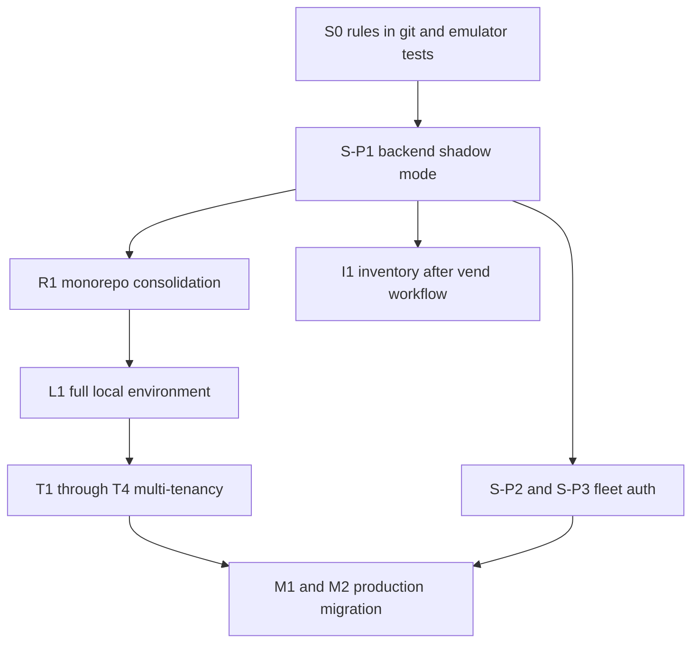

# Revised Implementation Roadmap

Status: **S0 IN PROGRESS** (local security tests only). Monorepo consolidation has not started.
Projects, in the approved order: **S** security · **R** monorepo · **L** full local environment ·
**T** multi-tenancy · **I** inventory · **M** production migration.
Nothing past S0 runs without its own approval. Payment code is not part of S0.

## 1. Approved sequence

Ordering rationale:

- S0 is the smallest test rig: versioned rules, authorization tests, and a source check that the
  four unused collections have no client reader. It does not deploy rules and does not edit
  `complete_vend_job`.
- S-P1 (shadow-mode auth flags) ships from the current Cloud repo before the repository move, so
  the move does not include a payment-path change. The vend-completion state machine is documented
  and waits for its own approval; it is not folded into S-P1 silently.
- The monorepo comes after that shadow deploy and before the full fixture set, Dev Console, and
  tenant schema, so those are created once. It has not been started.
- Inventory accounting is a separate milestone. It decrements stock inside the admission
  transaction described in the vend-completion workflow, which does not call Stripe.
- Production migration is last.

## 2. Milestones

Format per milestone: Scope · Dependencies · Likely affected · Acceptance · Automated tests ·
Manual steps · Rollback · Approval checkpoint.

### S0 — Security test foundation (current)

- **Scope:** Check the current public-read rules into `sellmate-dashboard/firebase/` for the
  emulator only. Repeatable tests for today's allows and denies. A second rules file that locks
  `checkout_sessions`, `stripe_event_receipts`, `commands`, and `activity`, tested and not
  deployed. A source scan that fails if a client starts reading those paths. Record which legacy
  clients are real (`docs/architecture/legacy-client-inventory.md`).
- **Dependencies:** Java 21 to run the emulator. The client scan does not need it.
- **Affected:** `sellmate-dashboard/firebase/**`, `package.json` scripts. No application code.
- **Not in scope:** production deploy, production data, Stripe or `complete_vend_job`, monorepo.
- **Acceptance:** `npm run test:rules:clients` passes. `npm run test:rules` passes when a JDK is
  available. `firebase.json` in this folder defaults to the `demo-sellmate` project, not
  `sellmate-bdd22`.
- **Rollback:** delete `sellmate-dashboard/firebase/`. Nothing in production changed.
- **Approval to go further:** deploy of the lockdown file; any edit to the payment path.

### S-P0 — Configuration verification (no code)

- **Scope:** IAM role of the touchscreen service account; `machine.env` and vend-api env values
  on real Pis; whether `SellMateKioskApp` is deployed anywhere (D5); Firebase Auth providers
  enabled; Cloud Run service account roles.
- **Dependencies:** none. **Affected:** none (console/SSH).
- **Acceptance:** findings table in `security-remediation-plan.md` §0 updated from `[?]` to
  verified values.
- **Tests:** n/a. **Manual:** your checklist. **Rollback:** n/a. **Approval:** none; your actions.

### L1 — Local development foundation

- **Scope:** `sellmate-dashboard/firebase/` (firebase.json, aliases, **exact live rules** as R0,
  empty indexes, rules test harness), `dev/fixtures` + `dev/seed` (v2 fixture set incl. personas,
  relationships, orders, expected totals), `dev/simulator/simulate_machine.py`,
  `dev/scenarios/*.json`, `Makefile`; dashboard env model + fail-fast + emulator wiring + badge;
  backend `SELLMATE_ENV`, emulator guard, `PAYMENTS_PROVIDER=fake`, `run_local.sh`; Java install
  instructions.
- **Dependencies:** none (Java on the dev machine).
- **Affected:** `sellmate-dashboard/{firebase,dev,packages/schemas,Makefile,lib/firebase.ts,.env.local.example}`,
  `SellMateCloud/{config.py,payments.py,run_local.sh,tests}`.
- **Acceptance:** `make up` → emulator UI, backend `/health`, dashboard with EMULATOR badge;
  `make reset && make seed` twice → identical counts/hashes; `make sim MACHINE=mach_ns_01
  SCENARIO=heartbeat` updates `health_status`; `SCENARIO=vend-success` with fake payments walks
  order → webhook → claim → complete → `COMPLETED`; `npm run test:rules` proves R0 = live
  behaviour.
- **Automated:** rules R0 tests; seed idempotency test; fixture schema validation; simulator
  smoke test; backend emulator-guard tests (`production` + emulator vars → startup failure).
- **Manual:** M0 §13 steps 1–3, 17.
- **Rollback:** delete the new directories; no production touch.
- **Approval:** D1 (location), D2 (`firebase-admin`), D8 (fake payments adapter), D13
  (`concurrently` vs shell).

### S-P1 — Backend shadow mode (security)

- **Scope:** `machine_credentials` + resolver; `POST /machines/{id}/credentials`;
  `VEND_AUTH_MODE`, `ORDER_AUTH_MODE`, `ORDER_PRICE_MODE`, `OPERATOR_ROLE_MODE` flags (legacy
  defaults); machine binding when a per-machine token is present; atomic `complete_vend_job`
  (S-08); `GET /machines/{id}/catalog`; structured auth metrics in `log_event`.
- **Dependencies:** L1 (tests). **Affected:** `SellMateCloud/{main.py,auth_machine.py (new),
  authz_flags.py (new),tests/}`.
- **Acceptance:** all legacy payload replays pass with default flags; each flag mode behaves per
  the plan; concurrency test shows one capture.
- **Automated:** `security-remediation-plan.md` §4 backend list.
- **Manual:** Dev Console scenarios `bad-token`, `manipulated-price` (log mode shows the mismatch
  event), `duplicate-complete`.
- **Rollback:** Cloud Run revision rollback; flags are env only.
- **Approval:** deploy of shadow-mode flags. The vend-completion workflow (D-V2-08) is a
  separate approval and is not implemented inside S-P1.

### T1 — Authentication and tenant-isolated read slice

- **Scope:** Firestore docs `organizations`, `members`, `users`, `platform_admins`; rules R1
  (new collections) + R2 (membership reads on `machines`, `orders`, `vend_jobs`,
  `checkout_sessions`, `topologyAudit`) written and tested but **not deployed**; dashboard Firebase
  Auth, `AuthGate`, `OrgSwitcher`, `OrgContext`, tenant-filtered Overview and Machines, forbidden/
  empty/revoked states; backend `firebase-admin`, `authz.py`, `GET /me`; `capabilities.json`
  (org-scoped and `operation` columns) in `packages/schemas` with the interim backend copy;
  `POST /orders` stamps `attribution` (`resolution: machine_current|unassigned|machine_missing`),
  `create_or_get_vend_job` copies it.
- **Dependencies:** L1. **Affected:** dashboard `app/`, `components/`, `lib/authz`, `lib/firebase.ts`;
  `firebase/firestore.rules`, `firebase/tests`; `SellMateCloud/{authz.py,main.py,requirements.txt,tests}`.
- **Acceptance:** personas sign in; `uid_bo_dual` switches orgs with no stale rows; totals match
  `expected_totals.json` for operator views; `uid_nobody`, `uid_rex_revoked` see the right states;
  direct Firestore read of another org's machine → `permission-denied` under R2 in the emulator;
  backend 403 for org B with org A token; legacy `machine_001` order stamped `unassigned`.
- **Automated:** rules tests for every case in M0 §10 unit 2.1 plus "unfiltered list denied";
  `test_authz_*`; attribution stamping tests; `GET /me` tests.
- **Manual:** M0 §13 steps 4–9, 15.
- **Rollback:** dashboard previous build; backend previous revision; rules not deployed yet.
- **Approval:** D3 (FastAPI for admin mutations), D7 (production sign-in provider), rules R1/R2
  **deploy** is a separate approval after the dashboard is live.

### R1 — Monorepo consolidation (mechanical)

- **Scope:** per `02-monorepo-integration.md` §5.2–5.3: `consolidate.sh`, root Makefile, npm
  workspaces, CI path filters, `git mv` of `firebase/ dev/ packages/ docs/` to root, delete the
  interim `capabilities.json` copy, update Pi install scripts and Cloud Run build config.
- **Dependencies:** L1, T1 complete and green; S-P1 deployed; D5 answered.
- **Affected:** everything by path; no behaviour change.
- **Acceptance:** from the consolidated tree, `make up && make test` green; each app builds
  independently (`make cloud-build`, `make dashboard-build`, `make kiosk-test`, …); a Cloud Run
  deploy from `apps/cloud` serves `/health`; Pi install from `apps/machine` works on a bench Pi or
  the simulator.
- **Automated:** the full existing suites, run from new paths.
- **Manual:** repeat T1 manual steps once from the monorepo.
- **Rollback:** old repositories remain untouched and tagged `pre-monorepo`; abandon the new repo.
- **Approval:** create the repository; freeze window (no other deploys).

### S-P2 — Client updates (security)

- **Scope:** `sellmate-pi/app/cloud_poller.py` sends `X-Machine-Token` on claim/complete;
  `pi-touchscreen/app/api/cloud_client.py` sends it on order routes; touchscreen
  `CATALOG_SOURCE=cloud` option; per-machine token issuance and `machine.env` update per Pi.
- **Dependencies:** S-P1 deployed. **Affected:** the two Pi apps, fleet ops runbook.
- **Acceptance:** telemetry shows `auth=per_machine` for each updated machine on all routes;
  legacy machines still vend.
- **Automated:** Pi unit tests for headers; catalog parity test.
- **Manual:** bench Pi (or simulator with the real poller code) against the local backend in
  `require` mode.
- **Rollback:** revert `machine.env` value; code change is backward compatible.
- **Approval:** fleet rollout schedule.

### T2 — Relationships, locations and historical attribution

- **Scope:** `locations`, `machine_assignments` (kinds `ownership/operation/placement`),
  assignment transaction with `expected_assignment_version`, `host_org_id` denormalisation,
  `POST /machines`, `POST/GET /machines/{id}/assignments`, `GET /orgs/{org}/assignments`,
  `locations` CRUD, `audit_events` writes; full `attribution` snapshot with assignment IDs;
  dashboard relationship-driven navigation, machine relationships + history tabs, Members page,
  Locations page; rules R1 additions for `locations`; `capabilities.json` `ownership` and `host`
  columns.
- **Dependencies:** T1 (R1 if consolidated). **Affected:** `apps/cloud/{assignments.py,main.py}`,
  dashboard pages, `packages/schemas`, `dev/fixtures`, rules.
- **Acceptance (behaviours from 01 §4.3):** `mach_transfer_01`: northside sees post-transfer orders
  only, bayview sees pre-transfer; `mach_moved_01`: host summaries split at the move;
  `mach_owned_xfer_01`: both owners see their ownership rows; mid-checkout transfer order stays with
  bayview; two concurrent transfers → one 409; `org_a_allinone` admin sees operate/own/host
  sections at once; self-role edit denied; admin cannot grant owner.
- **Automated:** transaction tests (emulator), attribution immutability (webhook + complete after
  transfer), history endpoint filtering per caller, rules tests for `locations` and machine reads by
  `host_org_id`.
- **Manual:** M0 §13 steps 10–13, 16; Dev Console "Transfer operator / Move machine / Transfer
  ownership" buttons with expected-vs-actual panel.
- **Rollback:** previous builds; new collections are inert if unused.
- **Approval:** D-V2-01..06 (model decisions in 04).

### T3 — Financial visibility and audit

- **Scope:** `GET /finance/summary` (`as=operator|owner|host`, grouping, unattributed bucket),
  `completed_at` on orders, `GET /orgs/{org}/audit`, dashboard revenue summary cards for owner and
  host views, Audit page; indexes for `attribution.*_org_id`.
- **Dependencies:** T2. **Affected:** `apps/cloud/{finance.py,main.py}`, dashboard, indexes file.
- **Acceptance:** owner `org_c_lessor` viewer sees per-machine gross for its machines and nothing
  else (403 on transactions); host `uid_hal_host` sees location revenue split before/after the
  move; operator totals via summary equal Firestore-derived totals; `unattributed` counts the
  `mach_unassigned_01` orders for owner `org_sellmate`; cross-org `org_id` → 403.
- **Automated:** summary tests against the fixture set (`expected_totals.json` owner/host
  sections); mixed-currency test; 403 matrix.
- **Manual:** sign in as each financial persona; compare with the expected-vs-actual panel.
- **Rollback:** remove routes; `completed_at` is additive.
- **Approval:** D-V2-07 (`completed_at` write in payment path); production index deploy.

### S-P3 — Enforcement flips (security)

- **Scope:** `VEND_AUTH_MODE=require`, `ORDER_AUTH_MODE=require`, `ORDER_PRICE_MODE=enforce`,
  `OPERATOR_ROLE_MODE=capped`, each after its telemetry gate (plan §2).
- **Dependencies:** S-P2 complete fleet-wide. **Affected:** Cloud Run env only.
- **Acceptance:** zero vend failures attributable to auth over 48 h after each flip.
- **Automated:** CI runs the backend suite in `require/enforce` modes.
- **Manual:** simulator in `bad-token` → 401; a real machine vends.
- **Rollback:** set the flag back. **Approval:** each flip.

### I1 — Inventory accounting

Defined in `../architecture/inventory-accounting-plan.md` §3. Dependencies: the vend-completion
workflow (admission transaction only; Stripe stays outside it). Not part of S0.

### T4 — Remaining tenant-scoped integrations

- **Scope:** commissioning principal from ID token (dashboard drops the role dropdown; LAN path
  unchanged), Theme Studio sign-in or service credential (`OPERATOR_ROLE_MODE=id_token_only`
  prerequisite), inventory/planogram edits scoped by rules or the I1 endpoint, health views by
  relationship, rules R3 after D5, `devices.manage` UI.
- **Dependencies:** T3, S-P3. **Affected:** dashboard commissioning, theme-studio, rules.
- **Acceptance:** commissioning as `uid_theo_operator` works; as `uid_vera_viewer` denied;
  Theme Studio publishes with a signed-in admin; anonymous inventory read denied (if R3).
- **Automated:** principal mapping tests; rules R3 tests. **Manual:** commissioning flow in the
  emulator with the simulator acting as the Pi.
- **Rollback:** `OPERATOR_ROLE_MODE=capped`; rules previous file. **Approval:** D6 retirement, R3
  deploy.

### M1 — Migration tooling and rehearsal

- **Scope:** M0 §7.4 commands (`inventory`, `apply-machines`, `backfill-commerce`, `verify`,
  `revert`) extended for `ownership` rows and the `attribution` object with
  `legacy_backfill|legacy_unknown`; legacy mapping manifest format; rehearsal against the emulator
  seeded with a production-shaped dataset; rollout runbook (dashboard → backend → rules R1/R2 →
  backfill → verify).
- **Dependencies:** T3 (summaries are the verification oracle). **Affected:** `apps/cloud/migration/`.
- **Acceptance:** dry run reports unmapped machines and never writes; execute on emulator then
  `verify` matches expected totals; `revert` removes only migration-tagged fields/rows and reports
  post-rollout records.
- **Automated:** migration unit + emulator tests. **Manual:** M0 §13 steps 18–19.
- **Rollback:** `revert`. **Approval:** manifest contents; **no production execution**.

### M2 — Production rollout

- **Scope:** execute the runbook on `sellmate-bdd22` with a Firestore export reference recorded.
- **Dependencies:** M1, R1 complete and quiet, security P3 done.
- **Approval:** explicit, step by step (dashboard deploy, backend deploy, each rules deploy,
  backfill `--execute`).

## 3. Test catalogue (scenario → fixture → oracle)

| Scenario (from the brief) | Fixture | Where asserted |
|---|---|---|
| Multiple organizations / memberships | all orgs; `uid_bo_dual` | T1 rules + UI |
| Platform admin | `uid_sam_platform` | T1 |
| Org owner / admin / operator / viewer | `uid_nina_owner`, `uid_dana_admin`, `uid_theo_operator`, `uid_vera_viewer` | T1, T2, T4 |
| Revoked membership; unrelated user | `uid_rex_revoked`, `uid_nobody` | T1 |
| Owned and operated by different orgs | `mach_sm_01` | T2 |
| Hosted by a third org | `mach_ns_01` @ `loc_beanhouse_cafe` | T2 |
| Historical operator transfer | `mach_transfer_01` | T2, T3 |
| Historical placement transfer | `mach_moved_01` | T2, T3 |
| Unassigned machine; legacy machine | `mach_unassigned_01`, `machine_001` | T1, T3, M1 |
| Owner + operator + host simultaneously | `org_a_allinone` | T2, T3 |
| Machine-owner financial visibility | `org_c_lessor` / `uid_cal_c_viewer` | T3 |
| Location-host financial visibility | `org_beanhouse` / `uid_hal_host` | T3 |
| Historical revenue after relocation | `mach_moved_01` orders | T3 |
| Unauthorized access to unrelated sales | any persona vs other org's orders | T1 rules, T3 403 |
| Machine transfer during active checkout | 09:59 order on `mach_transfer_01` | T2 |
| Revoked machine credentials | `mach_bv_01` revoked token | S-P1 |
| Manipulated purchase prices | scenario `manipulated-price` | S-P1 |
| Duplicate payment and vending events | scenarios `duplicate-webhook`, `duplicate-complete` | S-P1, I1 |
| Ownership transfer history | `mach_owned_xfer_01` | T2, T3 |
